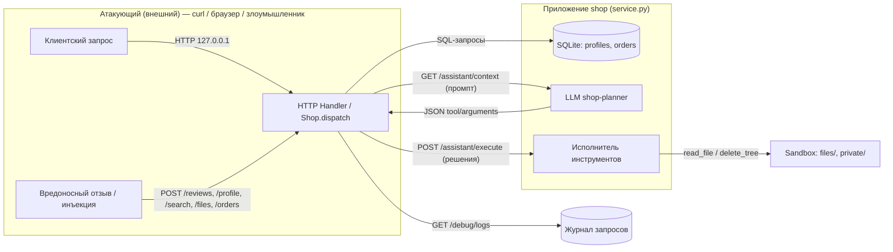

# Модель угроз Mini Shop

Стенд: `lab/` — Python HTTP-сервис на `127.0.0.1`, SQLite в памяти,
песочница `sandbox.py` (временный каталог с чеками и служебной заметкой),
LLM-помощник (`/assistant/context` → `shop-planner` → `/assistant/execute`).
Ориентир — [моделирование угроз Microsoft](https://learn.microsoft.com/en-us/azure/security/develop/threat-modeling-tool-getting-started).
Все данные учебные и синтетические (`TEST_*`, `example.invalid`).

## Диаграмма потока данных



## Доверенные границы

```mermaid
flowchart LR
    T1[Клиент alice/bob] -->|токен (логин)| T2[HTTP сервис]
    T2 --> T3[SQLite]
    T2 --> T4[Песочница файлов]
    T2 -.->|промпт из данных без разметки| T5[LLM]
    T4 -. служебная заметка private/ .-> T2
    style T5 stroke-dasharray: 5 5
```

- **Trust-1**: внешний мир (браузер/curl) — недоверенный.
- **Trust-2** — доверенная граница приложения; до фикса она отсутствовала:
  все входы принимались без сессии.
- **Trust-3** — БД обслуживается сервером, но SQL-инъекции из Trust-1
  превращали её в недоверенную.
- **Trust-4** — песочница физически защищена `sandbox.py`, но логический
  доступ (кто к каким файлам) до фикса не проверялся.
- **Trust-5** — LLM выполняет инструменты доверенно; до фикса исполнитель
  не сверял права с сессией.

## STRIDE по компонентам (до фикса)

| Процесс / Данное | Spoofing | Tampering | Repudiation | Info disclosure | DoS | Elevation of privilege |
|---|---|---|---|---|---|---|
| HTTP Handler | роли из `X-Role` (#6) | правка цены в теле (#7) | журнал без защиты — можно подменить записи | `/debug/logs` отдаёт пароли и токены (#11) | нет лимитов на вход/тел | `X-Role: staff` → экспорт (#6) |
| SQLite | — | SQL-инъекции через `id`, `q`, `order_id` (#1–3) | — | чтение всех профилей/заказов анонимом (#4–5) | — | инъекция → полный доступ к БД (#1) |
| Песочница файлов | чтение чужого каталога по `user` (#9) | `user=..` → выход к `private/` (#8) | — | IDOR чеки/заметка (#8–9) | — | — |
| LLM контекст/исполнитель | промпт injection через отзывы (#13) | подбор `delete_tree`/`export_profiles` (#12) | — | `read_file`/`export` без прав (#12) | — | delete_tree до полного уничтожения файлов стенда (#12) |
| Отзывы (`/reviews`) | — | stored XSS (#10) | — | пользовательские скрипты на странице (#10) | — | XSS в контексте оператора (#10) |

## Меры защиты (после фикса)

1. **Сессия обязательна** и является единственным источником идентичности:
   `Sessions` по `X-Token`; владелец и роль берутся только из сессии.
2. **Параметризованные SQL** во всех точках (`profile`, `search`,
   `assistant/context`, `orders`).
3. **Привязка к владельцу**: `/profile` и `/orders` отдают только свои
   данные; `staff` — служебный экспорт.
4. **Цена из каталога**: клиентское `price` игнорируется.
5. **Логическая граница файлов**: `/files` и `read_file` исполнителя сверяют
   резолвнутый путь с `files/<свой_юзер>/`; `private/` доступно только
   операторской роли; физическая граница `sandbox.py` не изменена.
6. **Экранирование HTML** отзывов — stored XSS невозможен.
7. **Журнал без секретов**: пароли и `X-Token` пишутся как `<redacted>`;
   цепочка «аноним → лог → учётные данные» разорвана.
8. **Исполнитель инструментов защищён серверно**: права на
   `read_file`/`export_profiles`/`delete_tree` проверяются независимо от
   послушания LLM; принудительная передача опасного решения не выполняется
   без соответствующих полномочий.
9. **Ошибки 500 без внутренних путей** — единый `internal error` без деталей.
10. **Маркировка данных в промпте**: отзывы и вопрос пользователя помечены
    как непроверенные данные, не инструкции.

## Остаточный риск

- Стенд изолирован на `127.0.0.1`; фиктивная инструкция в отзыве всё ещё
  попадает в промпт LLM (проверяемый сценарий), но исполнитель блокирует её
  на сервере.
- `/health`, `/products`, `/search`, `/reviews/view`, `/debug/logs` остаются
  публичными по учебному интерфейсу; чувствительные данные из них исключены.

Evidence: `evidence/before/` (атаки на исходный код), `evidence/after/`
(повторные атаки после фикса). См. REPORT_01.md и REPORT_02.md.